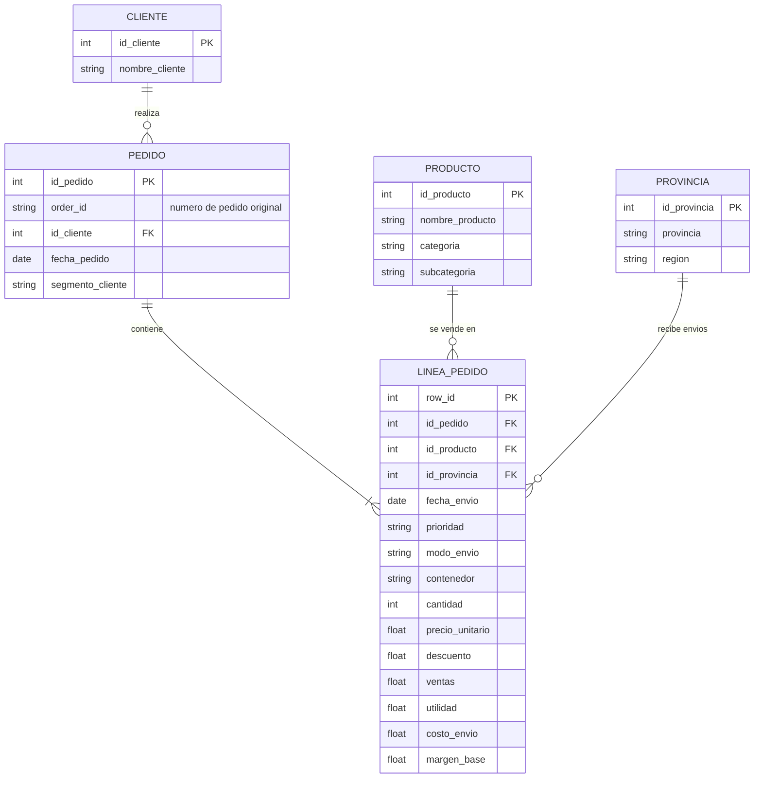
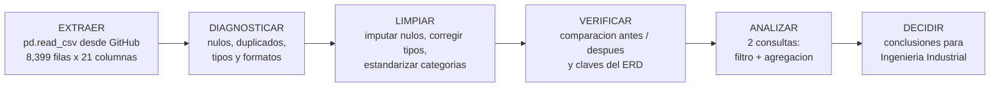

# Mini-proyecto de datos · Ventas y logística de una empresa de suministros de oficina

**Ciencia de Datos · Semana 10 · Cierre del Corte 2**

---

## Tabla de contenido

1. [Información general de la actividad](#1-información-general-de-la-actividad)
2. [Descripción y objetivo](#2-descripción-y-objetivo)
3. [Dataset y fuente](#3-dataset-y-fuente)
4. [Modelo entidad-relación (ERD)](#4-modelo-entidad-relación-erd)
5. [Extracción y carga de datos](#5-extracción-y-carga-de-datos)
6. [Diagnóstico inicial](#6-diagnóstico-inicial)
7. [Limpieza de datos](#7-limpieza-de-datos)
8. [Comparación antes y después](#8-comparación-antes-y-después)
9. [Pregunta y consulta 1](#9-pregunta-y-consulta-1)
10. [Pregunta y consulta 2](#10-pregunta-y-consulta-2)
11. [Documentación del flujo: extraer → limpiar → analizar](#11-documentación-del-flujo-extraer--limpiar--analizar)
12. [Conclusiones](#12-conclusiones)
13. [Referencias]
---

## 1. Información general de la actividad

| Campo | Detalle |
|---|---|
| **Programa** | Ingeniería Industrial |
| **Asignatura** | Ciencia de Datos |
| **Unidad** | 2 · Modelamiento, transformación y conexión de datos |
| **Semana / Corte** | 10 · Corte 2 |
| **Periodo** | 2026-B |
| **Modalidad** | Individual |
| **Tipo** | Formativa (opcional, sin nota) |
| **Autor** | Yilver *(completar con nombre y apellidos)* |
| **GitHub** | *(completar con tu usuario de GitHub)* |
| **Entrega** | Repositorio personal en GitHub, carpeta `10-week/` |
| **Herramientas** | Python 3, pandas, Mermaid |

---

## 2. Descripción y objetivo

Este mini-proyecto integra lo trabajado en el Corte 2: **modelo de datos, limpieza con pandas y consultas**. Se toma un dataset real de ventas, se diseña su modelo entidad-relación, se limpia y se responden dos preguntas de negocio con filtro y agregación, dejando documentado el flujo **extraer → limpiar → analizar**.

**Objetivos:**

- Integrar modelo, consultas y limpieza en un solo caso.
- Dejar los datos listos para analizar.

| Requisito de la guía | Dónde se cumple |
|---|---|
| Modelo de datos (ERD) | Sección 4 |
| Cargar un dataset (CSV) y limpiarlo en pandas | Secciones 5, 6, 7 y 8 |
| Responder 2 preguntas con consultas (filtro + agregación) | Secciones 9 y 10 |
| Dejar los datos listos y documentar el flujo | Secciones 7, 8 y 11 |

> **Sobre las cifras:** todos los resultados de este documento se obtuvieron ejecutando el código mostrado el **9 de octubre de 2026**, con **Python 3.13 y pandas 3.0.5**, sobre el archivo descargado desde la URL indicada en la sección 3.

### Caso de estudio

Una empresa canadiense vende **suministros de oficina, tecnología y mobiliario** y necesita entender sus **ventas, utilidades y tiempos y costos de envío**. Cada fila del dataset es una **línea de pedido**: un producto, comprado por un cliente, enviado a una provincia con un modo de envío determinado.

---

## 3. Dataset y fuente

| Característica | Detalle |
|---|---|
| **Nombre** | Superstore Sales (versión con provincias canadienses) |
| **Fuente** | Repositorio público `curran/data` en GitHub, carpeta `superstoreSales` |
| **Enlace de descarga** | <https://raw.githubusercontent.com/curran/data/gh-pages/superstoreSales/superstoreSales.csv> |
| **Formato** | CSV, codificación **Mac Roman** (`encoding="mac_roman"`) |
| **Filas × columnas (verificado)** | **8,399 × 21** |
| **Periodo cubierto** | Pedidos del 1 de enero de 2009 al 30 de diciembre de 2012 |
| **Clientes distintos** | 795 |
| **Productos distintos** | 1,263 |
| **Provincias distintas** | 13 |

**Columnas principales del archivo original:**

| Columna | Tipo original | Descripción |
|---|---|---|
| `Row ID` | int64 | Identificador de la línea de pedido. |
| `Order ID` | int64 | Número de pedido (un pedido tiene varias líneas). |
| `Order Date` / `Ship Date` | texto | Fechas de pedido y de envío (formato `mes/día/año`). |
| `Order Priority` | texto | Prioridad: Critical, High, Medium, Low, Not Specified. |
| `Order Quantity` | int64 | Unidades pedidas. |
| `Sales` | float64 | Valor de la venta de la línea. |
| `Discount` | float64 | Descuento aplicado (fracción). |
| `Profit` | float64 | Utilidad de la línea (puede ser negativa). |
| `Unit Price` | float64 | Precio unitario. |
| `Shipping Cost` | float64 | Costo de envío. |
| `Ship Mode` | texto | Modo de envío: Regular Air, Express Air, Delivery Truck. |
| `Customer Name` / `Customer Segment` | texto | Cliente y su segmento (Consumer, Corporate, Home Office, Small Business). |
| `Province` / `Region` | texto | Provincia y región de destino. |
| `Product Category` / `Product Sub-Category` / `Product Name` | texto | Clasificación y nombre del producto. |
| `Product Container` | texto | Tipo de empaque. |
| `Product Base Margin` | float64 | Margen base del producto (con valores nulos). |

**¿Por qué sirve este dataset?** Permite construir un modelo con más de tres entidades, y trae problemas reales de calidad (nulos, etiquetas mal escritas y fechas como texto), sin necesidad de "ensuciar" los datos. No se encontraron filas duplicadas exactas y eso también se documenta (sección 7.4).

---

## 4. Modelo entidad-relación (ERD)

El archivo es una **tabla plana**. Para modelarlo se revisó a qué nivel es consistente cada atributo (comprobado con `groupby(...).nunique()`):

| Hallazgo | Evidencia | Decisión de modelado |
|---|---|---|
| `Order ID` **no identifica por sí solo** un pedido | 5,496 valores de `Order ID`, pero 5,517 parejas (`Order ID`, cliente); 21 `Order ID` aparecen con más de un cliente | El pedido se identifica con la pareja (`Order ID`, cliente) → `id_pedido` sustituto |
| La fecha y el segmento son consistentes **dentro del pedido** | 0 pedidos con más de una fecha o más de un segmento | `fecha_pedido` y `segmento_cliente` van en `PEDIDO` |
| El segmento **no** es fijo por cliente | 176 clientes aparecen con más de un segmento | El segmento no va en `CLIENTE` |
| Provincia, modo de envío, precio y prioridad **varían dentro del pedido** | Hay pedidos con varias provincias y varios modos de envío | Van en `LINEA_PEDIDO` |
| Categoría y subcategoría son fijas por producto | 0 productos con más de una categoría o subcategoría | Van en `PRODUCTO` |
| Cada provincia pertenece a una sola región | Relación provincia → región 1 a 1 | Entidad `PROVINCIA` |



**Relaciones y cardinalidades:**

| Relación | Cardinalidad | Explicación |
|---|---|---|
| `CLIENTE` → `PEDIDO` | **Uno a muchos (1:N)** | Un cliente realiza muchos pedidos; cada pedido pertenece a un solo cliente. |
| `PEDIDO` → `LINEA_PEDIDO` | **Uno a muchos (1:N)** | Un pedido contiene una o más líneas (mínimo una). |
| `PRODUCTO` → `LINEA_PEDIDO` | **Uno a muchos (1:N)** | Un producto puede aparecer en muchas líneas; cada línea tiene un producto. |
| `PROVINCIA` → `LINEA_PEDIDO` | **Uno a muchos (1:N)** | Una provincia recibe muchas líneas; cada línea tiene una provincia de destino. |
| `PEDIDO` ↔ `PRODUCTO` | **Muchos a muchos (N:M)**, resuelta | Un pedido incluye varios productos y un producto está en varios pedidos; la tabla `LINEA_PEDIDO` rompe esta relación en dos 1:N. |

> **Alcance del modelo:** el ERD es el **diseño lógico** del caso. En este proyecto el análisis se hace sobre la tabla limpia en pandas; las tablas del modelo se derivan con código en la sección 7.7 solo para **verificar** que las claves son únicas y que no hay filas huérfanas. No se creó una base de datos.

---

## 5. Extracción y carga de datos

```python
import pandas as pd

URL = ("https://raw.githubusercontent.com/curran/data/gh-pages/"
       "superstoreSales/superstoreSales.csv")

crudo = pd.read_csv(URL, encoding="mac_roman")   # el archivo viene en codificación Mac Roman

print(crudo.head(3).to_string())
print("Dimensiones (filas, columnas):", crudo.shape)
crudo.info()
```

**Resultado obtenido:**

```text
Dimensiones (filas, columnas): (8399, 21)
```

| Row ID | Order ID | Order Date | Order Priority | Order Quantity | Sales | Ship Mode | Profit | Province | Product Category | Ship Date |
|---:|---:|---|---|---:|---:|---|---:|---|---|---|
| 1 | 3 | 10/13/2010 | Low | 6 | 261.54 | Regular Air | -213.25 | Nunavut | Office Supplies | 10/20/2010 |
| 49 | 293 | 10/1/2012 | High | 49 | 10123.02 | Delivery Truck | 457.81 | Nunavut | Office Supplies | 10/2/2012 |
| 50 | 293 | 10/1/2012 | High | 27 | 244.57 | Regular Air | 46.71 | Nunavut | Office Supplies | 10/3/2012 |

*(Se muestran solo algunas de las 21 columnas para que la tabla sea legible.)*

---

## 6. Diagnóstico inicial

```python
print(crudo.dtypes, "\n")

# Nulos por columna (solo las que tienen)
nulos = crudo.isnull().sum()
print("Nulos por columna:")
print(nulos[nulos > 0], "\n")

# Duplicados
print("Duplicados exactos (todas las columnas):", crudo.duplicated().sum())
print("Duplicados ignorando Row ID:", crudo.drop(columns="Row ID").duplicated().sum())

# Formatos y categorías inconsistentes
for col in ["Region", "Province", "Ship Mode", "Order Priority", "Customer Segment"]:
    print(f"\nValores de {col}:", sorted(crudo[col].unique()))

print("\nEjemplo de fechas (texto):", crudo["Order Date"].head(3).tolist())

# Espacios sobrantes en columnas de texto
txt = crudo.select_dtypes(include=["object", "string"]).columns
print("\nCeldas con espacios sobrantes:",
      int(sum((crudo[c] != crudo[c].str.strip()).sum() for c in txt)))
```

**Resultados obtenidos:**

| # | Aspecto revisado | Resultado | ¿Problema? |
|---:|---|---|---|
| 1 | **Nulos** | 63 en `Product Base Margin` (0.75 % de las filas); las demás columnas están completas | Sí |
| 2 | **Duplicados** | 0 exactos y 0 ignorando `Row ID` | No |
| 3 | **Fechas** | `Order Date` y `Ship Date` son **texto** (por ejemplo `10/13/2010`) | Sí |
| 4 | **Etiquetas mal escritas** | Región `Prarie` (1,706 filas) y provincia `Saskachewan` (913 filas) | Sí |
| 5 | **Nombres de columnas** | Con espacios y mayúsculas (`Order Date`, `Product Sub-Category`) | Sí, de formato |
| 6 | **Tipos** | `Order ID` es entero pero es un identificador; categorías guardadas como texto | Sí, de tipo |
| 7 | **Espacios sobrantes** | 0 celdas | No |
| 8 | **Valores imposibles** | Ninguna venta ni cantidad menor o igual a 0; ningún envío anterior al pedido | No |

Valores de las categorías con errores:

```text
Region:   ['Atlantic', 'Northwest Territories', 'Nunavut', 'Ontario', 'Prarie', 'Quebec', 'West', 'Yukon']
Province: [..., 'Saskachewan', ...]   (13 provincias en total)
```

> **Dato a tener en cuenta:** 4,264 líneas (50.8 %) tienen utilidad negativa. No es un error de captura: es parte del negocio y se analiza en la pregunta 2. Por eso **no se eliminan** valores de utilidad negativa.

---

## 7. Limpieza de datos

Se trabaja sobre una **copia** (`df`) para conservar el archivo original (`crudo`) y poder comparar el antes y el después.

### 7.1 Formatos de nombres y de texto

```python
df = crudo.copy()

# Nombres de columnas en snake_case: "Product Sub-Category" -> "product_sub_category"
df.columns = (df.columns.str.strip().str.lower()
                        .str.replace(r"[\s\-]+", "_", regex=True))

# Texto: quitar espacios al inicio, al final y espacios dobles
for col in df.select_dtypes(include=["object", "string"]).columns:
    df[col] = df[col].str.strip().str.replace(r"\s+", " ", regex=True)

# Estandarizar categorías mal escritas
df["region"] = df["region"].replace({"Prarie": "Prairie"})
df["province"] = df["province"].replace({"Saskachewan": "Saskatchewan"})
```

| Operación | Para qué sirve |
|---|---|
| `.str.lower()` y reemplazo de espacios | Nombres de columna fáciles de escribir en código. |
| `.str.strip()` y `\s+` → un espacio | Evita que `"Ontario "` y `"Ontario"` cuenten como categorías distintas. En este archivo no había espacios sobrantes, pero se deja como buena práctica. |
| `.replace({...})` | Corrige `Prarie` → `Prairie` (1,706 filas) y `Saskachewan` → `Saskatchewan` (913 filas). |

### 7.2 Corrección de tipos de datos

```python
df["order_date"] = pd.to_datetime(df["order_date"], format="%m/%d/%Y")
df["ship_date"] = pd.to_datetime(df["ship_date"], format="%m/%d/%Y")
df["order_id"] = df["order_id"].astype("string")          # identificador, no se suma
df["order_quantity"] = df["order_quantity"].astype("int32")
for col in ["order_priority", "ship_mode", "region", "province",
            "customer_segment", "product_category", "product_sub_category",
            "product_container"]:
    df[col] = df[col].astype("category")
```

| Columna | Antes | Después | Motivo |
|---|---|---|---|
| `order_date`, `ship_date` | texto | `datetime64` | Permite restar fechas y agrupar por año. Se indica el formato `%m/%d/%Y`, porque `10/1/2012` es el 1 de octubre y no el 10 de enero. |
| `order_id` | int64 | `string` | Es un código; no tiene sentido sumarlo ni promediarlo. |
| `order_quantity` | int64 | `int32` | Enteros pequeños (máximo 50). |
| Columnas categóricas | texto | `category` | Menos memoria y categorías explícitas. |

### 7.3 Tratamiento de valores nulos

**Columna afectada:** `product_base_margin`, con **63 nulos** (0.75 % de las filas), repartidos solo en cuatro subcategorías de mobiliario y almacenamiento:

| Subcategoría | Nulos | Mediana de la subcategoría usada para imputar |
|---|---:|---:|
| Chairs & Chairmats | 26 | 0.60 |
| Storage & Organization | 21 | 0.60 |
| Tables | 12 | 0.69 |
| Bookcases | 4 | 0.65 |

**Decisión:** **imputar** con la mediana de la misma subcategoría, y no eliminar las filas.

**Justificación:** esas 63 filas tienen ventas, utilidad y fechas válidas; eliminarlas habría descartado información de negocio por una sola columna incompleta. La mediana es más robusta que el promedio ante valores extremos, y las cuatro subcategorías sí tienen valores de margen en otras filas. El valor imputado es una **estimación**, por eso se agrega la columna `margen_imputado` para poder identificar o excluir esas filas más adelante.

```python
df["margen_imputado"] = df["product_base_margin"].isnull()      # marca de las filas imputadas
mediana_sub = df.groupby("product_sub_category", observed=True)["product_base_margin"].transform("median")
df["product_base_margin"] = df["product_base_margin"].fillna(mediana_sub)
```

### 7.4 Eliminación de duplicados

Se eliminan las filas repetidas **ignorando `row_id`**, porque ese identificador es distinto en cada línea y ocultaría una repetición real.

```python
columnas_clave = [c for c in df.columns if c not in ("row_id", "margen_imputado")]
duplicados = int(df.duplicated(subset=columnas_clave).sum())
df = df.drop_duplicates(subset=columnas_clave).reset_index(drop=True)
print("Duplicados eliminados:", duplicados)
```

**Resultado:** **0 duplicados eliminados**. El dataset no tenía filas repetidas.

**Revisión adicional:** hay 2 parejas de líneas con el mismo pedido, cliente y producto (`Order ID` 37603 con Liz Price y `Order ID` 32800 con Larry Tron). **No son duplicados**: difieren en cantidad, ventas y utilidad (por ejemplo, 50 y 23 unidades en el primer caso), es decir, son dos líneas distintas del mismo producto. Por eso se conservan.

### 7.5 Columnas derivadas y validaciones

```python
df["dias_envio"] = (df["ship_date"] - df["order_date"]).dt.days    # días entre pedido y envío
df["anio"] = df["order_date"].dt.year

# Validaciones de coherencia: si alguna falla, el código se detiene
assert (df["ship_date"] >= df["order_date"]).all(), "hay envíos antes del pedido"
assert (df["sales"] > 0).all() and (df["order_quantity"] > 0).all()
```

Las validaciones se cumplieron. Con esto las columnas pasan de 21 a **24** (`margen_imputado`, `dias_envio` y `anio`).

### 7.6 Resumen de decisiones de limpieza

| Problema | Acción | Resultado |
|---|---|---|
| 63 nulos en `product_base_margin` | Imputar con la mediana de la subcategoría y marcar con `margen_imputado` | 0 nulos |
| Fechas como texto | `pd.to_datetime` con formato explícito | 2 columnas `datetime` |
| `Prarie` y `Saskachewan` | Reemplazar por `Prairie` y `Saskatchewan` | 0 filas con el error |
| Nombres de columnas con espacios | `snake_case` | Columnas homogéneas |
| Tipos poco adecuados | `string`, `int32`, `category` | Tipos coherentes |
| Duplicados | `drop_duplicates` sin `row_id` | 0 encontrados |

### 7.7 Del archivo plano al modelo relacional (verificación del ERD)

Este bloque deriva las cinco tablas del ERD a partir de `df` y comprueba que las claves se cumplen.

```python
clientes = df[["customer_name"]].drop_duplicates().reset_index(drop=True)
clientes.insert(0, "id_cliente", range(1, len(clientes) + 1))

productos = (df[["product_name", "product_category", "product_sub_category"]]
             .drop_duplicates(subset="product_name").reset_index(drop=True))
productos.insert(0, "id_producto", range(1, len(productos) + 1))

provincias = df[["province", "region"]].drop_duplicates().reset_index(drop=True)
provincias.insert(0, "id_provincia", range(1, len(provincias) + 1))

pedidos = (df[["order_id", "customer_name", "order_date", "customer_segment"]]
           .drop_duplicates(subset=["order_id", "customer_name"]).reset_index(drop=True)
           .merge(clientes, on="customer_name")
           .drop(columns="customer_name"))
pedidos.insert(0, "id_pedido", range(1, len(pedidos) + 1))

lineas = (df.merge(pedidos[["id_pedido", "order_id", "id_cliente"]]
                   .merge(clientes, on="id_cliente")[["id_pedido", "order_id", "customer_name"]],
                   on=["order_id", "customer_name"])
            .merge(productos[["id_producto", "product_name"]], on="product_name")
            .merge(provincias[["id_provincia", "province"]], on="province"))

print("Clientes:", len(clientes), "| Pedidos:", len(pedidos), "| Productos:", len(productos),
      "| Provincias:", len(provincias), "| Líneas:", len(lineas))
print("PK de pedidos única:", pedidos["id_pedido"].is_unique)
print("PK de líneas única:", lineas["row_id"].is_unique)
print("FK sin correspondencia:", int(lineas[["id_pedido", "id_producto", "id_provincia"]].isnull().sum().sum()))
```

**Resultado obtenido:**

| Tabla | Filas | Verificación |
|---|---:|---|
| `CLIENTE` | 795 | PK única |
| `PEDIDO` | 5,517 | PK única; (`order_id`, cliente) única |
| `PRODUCTO` | 1,263 | PK única |
| `PROVINCIA` | 13 | Provincia → región 1 a 1 |
| `LINEA_PEDIDO` | 8,399 | PK (`row_id`) única; **0 claves foráneas huérfanas**; mismas filas que la tabla limpia |

---

## 8. Comparación antes y después

```python
comparacion = pd.DataFrame({
    "Indicador": ["Número de filas", "Número de columnas", "Valores nulos",
                  "Registros duplicados", "Filas con región 'Prarie'",
                  "Filas con provincia 'Saskachewan'", "Columnas de fecha tipo datetime"],
    "Antes": [len(crudo), crudo.shape[1], int(crudo.isnull().sum().sum()),
              int(crudo.duplicated().sum()), int((crudo["Region"] == "Prarie").sum()),
              int((crudo["Province"] == "Saskachewan").sum()), 0],
    "Después": [len(df), df.shape[1], int(df.isnull().sum().sum()),
                int(df.duplicated(subset=columnas_clave).sum()),
                int((df["region"] == "Prarie").sum()),
                int((df["province"] == "Saskachewan").sum()),
                int(df.dtypes.astype(str).str.startswith("datetime").sum())],
})
print(comparacion.to_string(index=False))
print(df.dtypes)
```

**Resultado obtenido al ejecutar el código:**

| Indicador | Antes de limpiar | Después de limpiar |
|---|---:|---:|
| **Número de filas** | 8,399 | 8,399 |
| **Número de columnas** | 21 | 24 |
| **Valores nulos** | 63 | 0 |
| **Registros duplicados** | 0 | 0 |
| Filas con región `Prarie` | 1,706 | 0 |
| Filas con provincia `Saskachewan` | 913 | 0 |
| Columnas de fecha tipo `datetime` | 0 | 2 |

**Cómo leer la tabla:**

- Las **filas no cambian** (8,399) porque no hubo duplicados y los nulos se imputaron en lugar de eliminar filas.
- Las **columnas suben de 21 a 24** por las tres columnas agregadas: `margen_imputado`, `dias_envio` y `anio`.
- Los **63 nulos pasaron a 0** gracias a la imputación documentada en la sección 7.3.

---

## 9. Pregunta y consulta 1

### Pregunta

> **En los pedidos de prioridad *Critical*, ¿qué modo de envío (Regular Air, Express Air o Delivery Truck) tarda menos en promedio y cuánto cuesta enviar con cada uno?**

### Justificación

Los pedidos críticos son los que más urgen. Si pagar un modo de envío más caro no entrega más rápido, la empresa puede estar gastando de más. La pregunta ayuda a decidir **qué modo asignar** a este tipo de pedidos.

### Consulta (filtro + agregación)

```python
crit = df[df["order_priority"] == "Critical"]                       # FILTRO: solo prioridad crítica

q1 = (crit.groupby("ship_mode", observed=True)                      # AGREGACIÓN: por modo de envío
          .agg(lineas=("row_id", "count"),
               dias_envio_prom=("dias_envio", "mean"),
               dias_envio_mediana=("dias_envio", "median"),
               costo_envio_prom=("shipping_cost", "mean"))
          .round(2).sort_values("dias_envio_prom"))

print("Líneas críticas:", len(crit))
print(q1)
```

### Resultado obtenido

Líneas con prioridad `Critical`: **1,608**.

| Modo de envío | Líneas | Días de envío (promedio) | Días de envío (mediana) | Costo de envío (promedio) |
|---|---:|---:|---:|---:|
| Express Air | 200 | 1.48 | 2.0 | 8.71 |
| Delivery Truck | 228 | 1.49 | 1.0 | 47.30 |
| Regular Air | 1,180 | 1.53 | 2.0 | 7.28 |

### Interpretación y hallazgo principal

- **Los tres modos tardan prácticamente lo mismo** en los pedidos críticos: entre 1.48 y 1.53 días en promedio. La diferencia entre el más rápido (Express Air) y el más lento (Regular Air) es de apenas 0.05 días.
- **El costo sí cambia mucho**: Express Air cuesta en promedio cerca de un 20 % más que Regular Air (8.71 frente a 7.28), y Delivery Truck cuesta unas **6.5 veces** más (47.30).
- **Hallazgo:** en estos datos, pagar Express Air no se traduce en entregas más rápidas para pedidos críticos; Regular Air entrega casi en el mismo tiempo con el menor costo.
- **Limitaciones:** es una comparación de promedios. El costo de envío puede depender del tamaño o peso de lo que se envía, y esa información no se controló; por eso se habla de lo observado y no de la causa. La diferencia de 0.05 días no se sometió a una prueba estadística.

---

## 10. Pregunta y consulta 2

### Pregunta

> **Entre las líneas de pedido con utilidad negativa, ¿qué subcategorías de producto concentran la mayor pérdida total?**

### Justificación

Más de la mitad de las líneas pierden dinero (sección 6). Identificar **dónde se concentra la pérdida** permite priorizar la revisión de precios, descuentos y costos en pocas subcategorías en lugar de revisar todo el catálogo.

### Consulta (filtro + agregación)

```python
perdidas = df[df["profit"] < 0]                                     # FILTRO: solo líneas con pérdida

q2 = (perdidas.groupby("product_sub_category", observed=True)       # AGREGACIÓN: por subcategoría
              .agg(lineas_con_perdida=("row_id", "count"),
                   perdida_total=("profit", "sum"))
              .round(2).sort_values("perdida_total"))               # la más negativa primero

print("Líneas con pérdida:", len(perdidas), "de", len(df),
      f"({len(perdidas)/len(df)*100:.1f} %)")
print("Pérdida total:", round(perdidas["profit"].sum(), 2))
print(q2.head(5))
```

### Resultado obtenido

- Líneas con pérdida: **4,264 de 8,399 (50.8 %)**.
- Pérdida total: **-1,102,503.01**.

Las cinco subcategorías con mayor pérdida (de 17 subcategorías con pérdidas):

| Subcategoría | Líneas con pérdida | Pérdida total |
|---|---:|---:|
| Office Machines | 128 | -203,879.55 |
| Tables | 258 | -191,116.57 |
| Storage & Organization | 379 | -111,221.06 |
| Chairs & Chairmats | 202 | -99,403.37 |
| Bookcases | 148 | -99,035.70 |

### Interpretación y hallazgo principal

- **Hallazgo:** dos subcategorías, **Office Machines y Tables**, suman unos 395 mil de pérdida, es decir, cerca del **35.8 %** de la pérdida total con solo 386 líneas (del total de 4,264). Con Storage & Organization, las tres concentran cerca del **45.9 %**.
- **Office Machines** tiene pocas líneas con pérdida (128) pero muy costosas, mientras que **Storage & Organization** acumula más líneas (379) con pérdidas individuales más pequeñas. Son problemas distintos: el primero apunta a pérdidas por línea muy altas; el segundo, a pérdidas frecuentes.
- **Limitaciones:** la consulta suma solo las líneas con pérdida; no considera las utilidades de las líneas rentables de la misma subcategoría, así que **no indica que la subcategoría completa pierda dinero**. Para decidir si se ajustan precios o descuentos habría que comparar con la utilidad neta por subcategoría.

---

## 11. Documentación del flujo: extraer → limpiar → analizar



| Etapa | Qué se hizo | Resultado |
|---|---|---|
| **Extraer** | Se descargó el CSV desde `raw.githubusercontent.com` con `pd.read_csv(..., encoding="mac_roman")`. | 8,399 filas × 21 columnas. |
| **Diagnosticar** | Se revisaron tipos, nulos, duplicados, categorías y fechas (sección 6). | Se detectaron 63 nulos, fechas como texto y dos etiquetas mal escritas; 0 duplicados. |
| **Limpiar** | Se estandarizaron nombres, se corrigieron tipos, se imputaron los nulos con mediana por subcategoría y se corrigieron `Prarie` y `Saskachewan` (sección 7). | 0 nulos; fechas como `datetime`. |
| **Verificar** | Se comparó el antes y el después y se derivaron las tablas del ERD (secciones 7.7 y 8). | 8,399 filas conservadas; claves únicas y sin filas huérfanas. |
| **Analizar** | Se formularon dos preguntas y se respondieron con filtro y `groupby` (secciones 9 y 10). | Un hallazgo logístico y uno de rentabilidad. |

---

## 12. Conclusiones

- **La limpieza fue necesaria y no destructiva:** se corrigieron los problemas reales del archivo sin perder filas (8,399 antes y después). Los **63 nulos** se imputaron y se marcaron con `margen_imputado`, las **fechas** pasaron de texto a `datetime`, y se corrigieron `Prarie` (1,706 filas) y `Saskachewan` (913 filas).
- **Principales problemas detectados:** nulos en el margen base, fechas como texto, categorías mal escritas y un `Order ID` que no identifica por sí solo al pedido (21 `Order ID` con más de un cliente). No se encontraron filas duplicadas.
- **Modelo de datos:** el ERD con cinco entidades (`CLIENTE`, `PEDIDO`, `PRODUCTO`, `PROVINCIA`, `LINEA_PEDIDO`) se comprobó con los datos: claves únicas y sin claves foráneas huérfanas.
- **Consulta 1:** en pedidos de prioridad crítica, los tres modos de envío tardan casi lo mismo (1.48 a 1.53 días en promedio), pero Express Air cuesta cerca de un 20 % más que Regular Air y Delivery Truck unas 6.5 veces más.
- **Consulta 2:** el 50.8 % de las líneas tiene utilidad negativa, y Office Machines y Tables concentran cerca del 35.8 % de la pérdida total en esas líneas.
- **Utilidad para Ingeniería Industrial:** los resultados orientan dos decisiones concretas: revisar si conviene pagar modos de envío más costosos cuando no reducen el tiempo, y priorizar el análisis de precios y descuentos en las subcategorías donde se concentra la pérdida.
- **Limitaciones:** las diferencias de la consulta 1 se describen solo con promedios y medianas, sin pruebas estadísticas; la consulta 2 no calcula la utilidad neta por subcategoría; y el margen imputado es una estimación.

---


## 13. Referencias

- Curran, M. (s. f.). *superstoreSales.csv* [Conjunto de datos]. Repositorio `curran/data`, GitHub. <https://raw.githubusercontent.com/curran/data/gh-pages/superstoreSales/superstoreSales.csv>
- The pandas development team. (s. f.). *pandas documentation*. <https://pandas.pydata.org/docs/>
- The pandas development team. (s. f.). *Working with missing data*. <https://pandas.pydata.org/docs/user_guide/missing_data.html>
- The pandas development team. (s. f.). *Group by: split-apply-combine*. <https://pandas.pydata.org/docs/user_guide/groupby.html>
- Mermaid. (s. f.). *Entity relationship diagrams*. <https://mermaid.js.org/syntax/entityRelationshipDiagram.html>
- Corporación Universitaria del Huila – CORHUILA. (2026). *Guía de actividad práctica: Ciencia de Datos, Semana 10 · Mini-proyecto de datos (cierre C2)*. Material de la asignatura.
