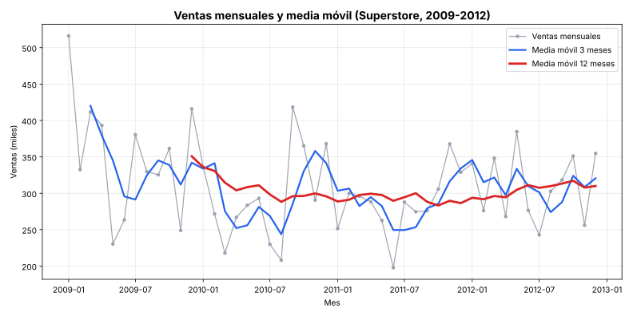

# Ciencia de Datos · Semana 11 · Análisis de una serie de tiempo

**Caso:** Ventas mensuales de una empresa de suministros de oficina
**Programa:** Ingeniería Industrial · **Unidad 3:** Análisis temporal, visualización y optimización
**Autor:** Angelica Vargas Zambrano · **GitHub:** [avargas-2024a-del](https://github.com/avargas-2024a-del) · **Periodo:** 2026-B
**Herramientas:** Python 3, pandas, matplotlib

---

## Tabla de contenido

1. [Descripción del proyecto](#1-descripción-del-proyecto)
2. [Serie temporal](#2-serie-temporal)
3. [Script](#3-script)
4. [Carga y agregación temporal](#4-carga-y-agregación-temporal)
5. [Media móvil y gráfico](#5-media-móvil-y-gráfico)
6. [Interpretación: tendencia y estacionalidad](#6-interpretación-tendencia-y-estacionalidad)
7. [Conclusiones](#7-conclusiones)
8. [Referencias](#8-referencias)

---

## 1. Descripción del proyecto

Esta guía de la Semana 11 pide tomar una **serie temporal** (ventas, producción o temperatura), cargarla en pandas con la **fecha como índice**, **agregarla por mes** con `resample`, calcular una **media móvil** con `rolling` y describir la **tendencia** y la **estacionalidad** observadas, con un script y un gráfico.

Para cumplirlo se usó la serie de **ventas** del dataset **Superstore Sales** (el mismo de los trabajos anteriores): 8,399 líneas de pedido con su fecha, entre 2009 y 2012. Los datos son reales, no simulados.

| Requisito de la guía | Dónde se cumple |
|---|---|
| Cargar la serie con la fecha como índice | Sección 4 |
| Agregar por mes (`resample`) | Sección 4 |
| Media móvil (`rolling`) | Sección 5 |
| Script + gráfico de la serie con su media móvil | Secciones 3 y 5 (archivos `serie_tiempo.py` y `grafico_serie_tiempo.svg`) |
| Describir tendencia y estacionalidad (2–3 líneas) | Sección 6 |

---

## 2. Serie temporal

| Característica | Detalle |
|---|---|
| **Nombre** | Superstore Sales (`superstoreSales.csv`) |
| **Fuente** | Repositorio público `curran/data` en GitHub, carpeta `superstoreSales` |
| **Enlace directo al CSV** | <https://raw.githubusercontent.com/curran/data/gh-pages/superstoreSales/superstoreSales.csv> |
| **Variable analizada** | `sales` (valor de la venta de cada línea de pedido) |
| **Fecha usada como índice** | `order_date` (fecha del pedido) |
| **Registros** | 8,399 líneas de pedido |
| **Rango de fechas** | Del 1 de enero de 2009 al 30 de diciembre de 2012 |
| **Frecuencia original** | Irregular (varios pedidos por día; hay días sin pedidos) |
| **Frecuencia tras agregar** | Mensual: 48 meses, sin meses vacíos |
| **Nulos en `sales`** | 0 |

---

## 3. Script

El mismo script está en el archivo [`serie_tiempo.py`](serie_tiempo.py) de esta carpeta. Al ejecutarlo imprime los resultados de las secciones 4 a 6 y guarda el gráfico `grafico_serie_tiempo.svg`.

```python
import pandas as pd
import matplotlib
matplotlib.use("Agg")                      # permite guardar el gráfico sin abrir ventana
import matplotlib.pyplot as plt

URL = ("https://raw.githubusercontent.com/curran/data/gh-pages/"
       "superstoreSales/superstoreSales.csv")

# ---------------------------------------------------------------
# 1) CARGA: la fecha del pedido se convierte en el índice
# ---------------------------------------------------------------
df = pd.read_csv(URL, encoding="mac_roman")
df.columns = (df.columns.str.strip().str.lower()
                        .str.replace(r"[\s\-]+", "_", regex=True))
df["order_date"] = pd.to_datetime(df["order_date"], format="%m/%d/%Y")

ventas = df.set_index("order_date").sort_index()["sales"]

print("Registros:", len(ventas))
print("Tipo de índice:", type(ventas.index).__name__)
print("Rango de fechas:", ventas.index.min().date(), "->", ventas.index.max().date())
print("Nulos en ventas:", int(ventas.isnull().sum()))

# ---------------------------------------------------------------
# 2) AGREGACIÓN MENSUAL (resample) Y MEDIA MÓVIL (rolling)
# ---------------------------------------------------------------
mensual = ventas.resample("MS").sum()                  # MS = inicio de cada mes
media_3m = mensual.rolling(window=3).mean()            # media móvil de 3 meses
media_12m = mensual.rolling(window=12).mean()          # media móvil de 12 meses

tabla = pd.DataFrame({"ventas_mes": mensual,
                      "media_movil_3m": media_3m,
                      "media_movil_12m": media_12m}).round(2)

print("\nMeses en la serie:", len(mensual))
print("Meses sin ventas:", int((mensual == 0).sum()))
print("\nPrimeras filas:")
print(tabla.head(14).to_string())

# ---------------------------------------------------------------
# 3) APOYO PARA LA INTERPRETACIÓN
# ---------------------------------------------------------------
print("\nVentas por año:")
print(mensual.groupby(mensual.index.year).sum().round(2))

print("\nPromedio de ventas por mes del año (estacionalidad):")
print(mensual.groupby(mensual.index.month).mean().round(2))

print("\nMedia móvil de 12 meses al cierre de cada año:")
print(media_12m[media_12m.index.month == 12].round(2))

# ---------------------------------------------------------------
# 4) GRÁFICO: serie mensual + medias móviles
# ---------------------------------------------------------------
fig, ax = plt.subplots(figsize=(11, 5.5))
ax.plot(mensual.index, mensual / 1000, color="#9ca3af", marker="o",
        markersize=3.5, linewidth=1.2, label="Ventas mensuales")
ax.plot(media_3m.index, media_3m / 1000, color="#2563eb", linewidth=2.2,
        label="Media móvil 3 meses")
ax.plot(media_12m.index, media_12m / 1000, color="#dc2626", linewidth=2.8,
        label="Media móvil 12 meses")
ax.set_title("Ventas mensuales y media móvil (Superstore, 2009-2012)", fontsize=14, fontweight="bold")
ax.set_xlabel("Mes")
ax.set_ylabel("Ventas (miles)")
ax.grid(alpha=0.3)
ax.legend()
fig.tight_layout()
fig.savefig("grafico_serie_tiempo.svg")
print("\nGráfico guardado: grafico_serie_tiempo.svg")
```

---

## 4. Carga y agregación temporal

**Carga.** El archivo se lee con `encoding="mac_roman"` (no es UTF-8). La columna `order_date`, que viene como texto, se convierte a fecha con `pd.to_datetime(..., format="%m/%d/%Y")`, se pone como **índice** con `set_index` y se ordena con `sort_index`. El resultado es una serie de pandas con un `DatetimeIndex`.

**Agregación.** `resample("MS").sum()` agrupa las ventas por mes (`MS` = *month start*, es decir, cada mes se identifica con su primer día) y las suma.

Resultado impreso por el script:

```text
Registros: 8399
Tipo de índice: DatetimeIndex
Rango de fechas: 2009-01-01 -> 2012-12-30
Nulos en ventas: 0

Meses en la serie: 48
Meses sin ventas: 0
```

Con esto, las 8,399 líneas de pedido se convierten en **48 puntos mensuales**. Ventas totales por año:

| Año | Ventas totales |
|---:|---:|
| 2009 | 4,209,139.46 |
| 2010 | 3,549,680.80 |
| 2011 | 3,436,816.70 |
| 2012 | 3,719,963.86 |

---

## 5. Media móvil y gráfico

Una **media móvil** reemplaza cada valor por el promedio de los últimos *n* meses. Así se suavizan las subidas y bajadas de un mes a otro y se ve mejor el comportamiento de fondo. Se calcularon dos con `rolling(window=n).mean()`:

- **3 meses:** reacciona rápido y deja ver los cambios de corto plazo.
- **12 meses:** promedia un año completo, por lo que elimina el efecto de los meses del año y muestra la **tendencia**.

Las primeras posiciones quedan vacías (`NaN`) porque todavía no hay suficientes meses para calcular el promedio: 2 vacías en la de 3 meses y 11 en la de 12 meses.

Primeras filas de la tabla (valores en unidades de venta):

| Mes | ventas_mes | media_movil_3m | media_movil_12m |
|---|---:|---:|---:|
| 2009-01 | 516,302.96 | NaN | NaN |
| 2009-02 | 332,480.64 | NaN | NaN |
| 2009-03 | 411,628.73 | 420,137.44 | NaN |
| 2009-04 | 393,276.48 | 379,128.62 | NaN |
| 2009-05 | 230,145.54 | 345,016.92 | NaN |
| 2009-06 | 263,456.07 | 295,626.03 | NaN |
| 2009-07 | 380,503.97 | 291,368.53 | NaN |
| 2009-08 | 329,754.72 | 324,571.58 | NaN |
| 2009-09 | 325,292.31 | 345,183.67 | NaN |
| 2009-10 | 361,555.27 | 338,867.43 | NaN |
| 2009-11 | 248,933.43 | 311,927.00 | NaN |
| 2009-12 | 415,809.35 | 342,099.35 | 350,761.62 |
| 2010-01 | 336,526.68 | 333,756.49 | 335,780.26 |
| 2010-02 | 271,580.51 | 341,305.51 | 330,705.25 |

**Gráfico:**



La línea gris son las ventas de cada mes, la azul la media móvil de 3 meses y la roja la de 12 meses.

---

## 6. Interpretación: tendencia y estacionalidad

**Tendencia.** Las ventas bajaron entre 2009 y 2011 y se recuperaron un poco en 2012. La media móvil de 12 meses pasó de **350,761.62** (diciembre de 2009) a un mínimo de **283,244.52** (octubre de 2011) y terminó en **309,996.99** (diciembre de 2012). Esto coincide con las ventas anuales: 4.21 millones en 2009, 3.55 en 2010, 3.44 en 2011 y 3.72 en 2012. Una recta ajustada a los 48 meses tiene pendiente negativa (cerca de -951 por mes), así que, en el periodo completo, la tendencia general es ligeramente descendente.

**Estacionalidad.** Al promediar cada mes del año sobre los 4 años, los meses más altos son **diciembre (366,872)**, **enero (361,231)** y **octubre (345,929)**, y el más bajo es **junio (257,715)**. Es decir, las ventas tienden a ser mayores hacia fin y comienzo de año y menores a mitad de año. Esta estacionalidad es **débil y solo indicativa**: hay solo 4 años de datos y los meses cambian mucho de un año a otro (por ejemplo, el valor más alto de toda la serie es enero de 2009, con 516,302.96, y el más bajo es junio de 2011, con 197,740.85), por lo que no se puede afirmar un patrón fijo.

---

## 7. Conclusiones

- Se cargó la serie de ventas con la fecha como índice (`DatetimeIndex`) y se agregó por mes con `resample`, pasando de 8,399 líneas de pedido a 48 meses sin huecos.
- Se calcularon medias móviles de 3 y 12 meses con `rolling` y se graficaron junto con la serie original.
- La **tendencia** es descendente entre 2009 y 2011, con una recuperación parcial en 2012.
- La **estacionalidad** es débil: ventas algo más altas en diciembre, enero y octubre, y más bajas en junio, pero con solo 4 años no se puede asegurar que sea un patrón estable.
- Limitación: los resultados describen lo que muestran los datos; no se puede saber la causa de la baja o de las diferencias entre meses con este dataset.

---

## 8. Referencias

- Curran, M. (s. f.). *superstoreSales.csv* [Conjunto de datos]. Repositorio `curran/data`, GitHub. <https://raw.githubusercontent.com/curran/data/gh-pages/superstoreSales/superstoreSales.csv>
- The pandas development team. (s. f.). *pandas.DataFrame.resample*. <https://pandas.pydata.org/docs/reference/api/pandas.DataFrame.resample.html>
- The pandas development team. (s. f.). *pandas.DataFrame.rolling*. <https://pandas.pydata.org/docs/reference/api/pandas.DataFrame.rolling.html>
- The pandas development team. (s. f.). *Time series / date functionality*. <https://pandas.pydata.org/docs/user_guide/timeseries.html>
- The pandas development team. (s. f.). *Windowing operations*. <https://pandas.pydata.org/docs/user_guide/window.html>
- Hunter, J. D. et al. (s. f.). *Matplotlib documentation*. <https://matplotlib.org/stable/>
- Corporación Universitaria del Huila – CORHUILA. (2026). *Guía de actividad práctica: Ciencia de Datos, Semana 11 · Análisis de una serie de tiempo*. Material de la asignatura.
