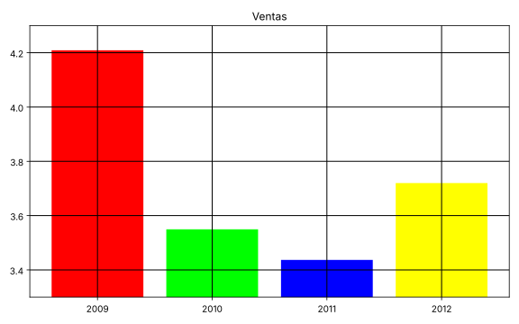
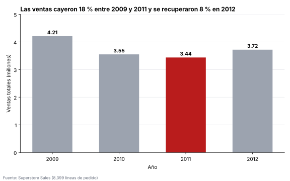

# Ciencia de Datos · Semana 12 · Rediseña un gráfico

**Caso:** Ventas anuales de una empresa de suministros de oficina
**Programa:** Ingeniería Industrial · **Unidad 3:** Análisis temporal, visualización y optimización
**Autor:** Angelica Vargas Zambrano · **GitHub:** [avargas-2024a-del](https://github.com/avargas-2024a-del) · **Periodo:** 2026-B
**Herramientas:** Python 3, pandas, matplotlib

---

## Tabla de contenido

1. [Descripción del proyecto](#1-descripción-del-proyecto)
2. [Datos](#2-datos)
3. [Gráfico ANTES y diagnóstico del problema](#3-gráfico-antes-y-diagnóstico-del-problema)
4. [Gráfico DESPUÉS: rediseño](#4-gráfico-después-rediseño)
5. [Qué mejoré y por qué](#5-qué-mejoré-y-por-qué)
6. [Script](#6-script)
7. [Conclusiones](#7-conclusiones)
8. [Referencias](#8-referencias)

---

## 1. Descripción del proyecto

Esta guía de la Semana 12 pide elegir (o crear) un **gráfico mal hecho**, rediseñarlo aplicando principios de visualización (**gráfico correcto, escala honesta, título con conclusión y color con propósito**) y explicar en 3–4 líneas qué se mejoró y por qué.

Como el trabajo permite crear el gráfico, se **construyó a propósito un gráfico defectuoso** con datos reales: las **ventas totales por año** del dataset Superstore Sales. Los datos son reales; lo que se hizo mal a propósito es el **diseño** del gráfico. Después se rediseñó con los mismos datos.

| Requisito de la guía | Dónde se cumple |
|---|---|
| Gráfico mal hecho | Sección 3 (`grafico_antes.svg`) |
| Rediseño con los principios | Sección 4 (`grafico_despues.svg`) |
| Explicación de qué se mejoró y por qué | Sección 5 |
| Antes/después (imágenes) + justificación | Secciones 3, 4 y 5 |

---

## 2. Datos

| Característica | Detalle |
|---|---|
| **Dataset** | Superstore Sales (`superstoreSales.csv`) |
| **Fuente** | Repositorio público `curran/data` en GitHub, carpeta `superstoreSales` |
| **Enlace directo al CSV** | <https://raw.githubusercontent.com/curran/data/gh-pages/superstoreSales/superstoreSales.csv> |
| **Variable** | Suma de `sales` por año de `order_date` |
| **Registros usados** | 8,399 líneas de pedido (2009 a 2012) |

Ventas totales por año (resultado del script):

| Año | Ventas totales (millones) |
|---:|---:|
| 2009 | 4.21 |
| 2010 | 3.55 |
| 2011 | 3.44 |
| 2012 | 3.72 |

Cambios que usa el título del gráfico final: de 2009 a 2011 las ventas cambiaron **-18.3 %**, y de 2011 a 2012 **+8.2 %**.

---

## 3. Gráfico ANTES y diagnóstico del problema



**Diagnóstico:**

| # | Problema | Qué se ve en el gráfico | Por qué es un problema |
|---:|---|---|---|
| 1 | **Eje truncado** | El eje vertical empieza en 3.3 y no en 0. | Las barras dejan de ser proporcionales a los valores y exageran las diferencias. |
| 2 | **Título sin información** | Dice solo "Ventas". | No indica qué se mide, en qué unidad ni qué conclusión debe sacar el lector. |
| 3 | **Color sin propósito** | Cada barra tiene un color saturado distinto (rojo, verde, azul, amarillo). | Los colores no significan nada y distraen; parece que cada año es una categoría diferente. |
| 4 | **Sin unidades ni etiquetas** | No hay nombre de ejes ni valores sobre las barras. | No se sabe si son pesos, miles o millones; hay que adivinar el valor leyendo la cuadrícula. |
| 5 | **Cuadrícula pesada** | Líneas negras gruesas que cruzan las barras. | Compite con los datos y ensucia el gráfico. |

**Evidencia numérica del problema 1.** El script calcula cuánto exagera el eje truncado:

```text
Razón real 2009 / 2011:           1.22 veces
Razón visual en el gráfico ANTES: 6.64 veces
```

En los datos reales, 2009 vendió **1.22 veces** lo de 2011 (un 22 % más). Pero en el gráfico "antes", la barra de 2009 se ve **6.64 veces** más alta que la de 2011. El gráfico hace que una caída moderada parezca un desplome.

---

## 4. Gráfico DESPUÉS: rediseño



**Principios aplicados:**

| Principio | Cómo se aplicó |
|---|---|
| **Gráfico correcto** | Se mantienen barras, que son adecuadas para comparar el total de cada año (solo 4 valores). |
| **Escala honesta** | El eje vertical empieza en **0**, así que la altura de cada barra es proporcional al valor. |
| **Título con conclusión** | "Las ventas cayeron 18 % entre 2009 y 2011 y se recuperaron 8 % en 2012": dice lo que el lector debe ver. |
| **Color con propósito** | Todas las barras son grises salvo **2011** (el valor más bajo), en rojo, que es lo que el título destaca. |
| **Claridad** | Valores escritos sobre cada barra, eje con unidad ("millones"), cuadrícula suave, sin bordes superior y derecho y con la fuente de los datos. |

---

## 5. Qué mejoré y por qué

Mejoré la **escala**: el eje ahora empieza en cero, así que ya no exagera la caída (de 6.64 veces visual a la proporción real de 1.22). Cambié el **título** de "Ventas" a una frase con la conclusión (caída de 18 % y recuperación de 8 %), para que el lector entienda el mensaje sin analizar el gráfico. Reemplacé los cuatro colores saturados por gris y **resalté solo 2011** en rojo, porque el color debe guiar la atención hacia lo importante. Finalmente agregué **valores, unidad y fuente**, para que el gráfico se pueda leer y verificar sin adivinar.

---

## 6. Script

El mismo script está en el archivo [`rediseno_grafico.py`](rediseno_grafico.py) de esta carpeta. Al ejecutarlo imprime los datos y las cifras del diagnóstico, y guarda `grafico_antes.svg` y `grafico_despues.svg`.

```python
import pandas as pd
import matplotlib
matplotlib.use("Agg")
import matplotlib.pyplot as plt

URL = ("https://raw.githubusercontent.com/curran/data/gh-pages/"
       "superstoreSales/superstoreSales.csv")

# ---------------------------------------------------------------
# 1) DATOS: ventas totales por año
# ---------------------------------------------------------------
df = pd.read_csv(URL, encoding="mac_roman")
df.columns = (df.columns.str.strip().str.lower()
                        .str.replace(r"[\s\-]+", "_", regex=True))
df["order_date"] = pd.to_datetime(df["order_date"], format="%m/%d/%Y")

anual = df.groupby(df["order_date"].dt.year)["sales"].sum()
anios = [str(a) for a in anual.index]
millones = anual / 1_000_000

print("Ventas por año (millones):")
print(millones.round(2))

cambio_09_11 = (anual[2011] / anual[2009] - 1) * 100
cambio_11_12 = (anual[2012] / anual[2011] - 1) * 100
print(f"\nCambio 2009 -> 2011: {cambio_09_11:.1f} %")
print(f"Cambio 2011 -> 2012: {cambio_11_12:+.1f} %")

# ---------------------------------------------------------------
# 2) EVIDENCIA DEL PROBLEMA: cuánto exagera el eje truncado
# ---------------------------------------------------------------
BASE = 3.3                                    # el eje "antes" empieza aquí
real = anual[2009] / anual[2011]
visual = (millones[2009] - BASE) / (millones[2011] - BASE)
print(f"\nRazón real 2009 / 2011:           {real:.2f} veces")
print(f"Razón visual en el gráfico ANTES: {visual:.2f} veces")

# ---------------------------------------------------------------
# 3) GRÁFICO ANTES (mal hecho a propósito)
# ---------------------------------------------------------------
fig, ax = plt.subplots(figsize=(8, 5))
ax.bar(anios, millones, color=["#ff0000", "#00ff00", "#0000ff", "#ffff00"])
ax.set_ylim(BASE, 4.3)                        # eje truncado
ax.set_title("Ventas")                        # título sin información
ax.grid(True, color="black", linewidth=1)     # cuadrícula pesada
fig.tight_layout()
fig.savefig("grafico_antes.svg")
plt.close(fig)

# ---------------------------------------------------------------
# 4) GRÁFICO DESPUÉS (rediseñado)
# ---------------------------------------------------------------
GRIS, ROJO = "#9ca3af", "#b91c1c"
colores = [GRIS, GRIS, ROJO, GRIS]            # solo el mínimo (2011) se resalta

fig, ax = plt.subplots(figsize=(8, 5))
barras = ax.bar(anios, millones, color=colores, width=0.6)
ax.set_ylim(0, 5)                             # el eje empieza en cero

for barra, valor in zip(barras, millones):    # etiquetas directas
    ax.text(barra.get_x() + barra.get_width() / 2, valor + 0.07,
            f"{valor:.2f}", ha="center", fontweight="bold")

ax.set_title(f"Las ventas cayeron {abs(cambio_09_11):.0f} % entre 2009 y 2011 "
             f"y se recuperaron {cambio_11_12:.0f} % en 2012",
             fontsize=12, fontweight="bold", loc="left")
ax.set_ylabel("Ventas totales (millones)")
ax.set_xlabel("Año")
ax.yaxis.grid(True, color="#e5e7eb")
ax.set_axisbelow(True)
for lado in ["top", "right"]:
    ax.spines[lado].set_visible(False)
fig.text(0.01, 0.01, "Fuente: Superstore Sales (8,399 líneas de pedido)",
         fontsize=8, color="#6b7280")
fig.tight_layout(rect=(0, 0.03, 1, 1))
fig.savefig("grafico_despues.svg")
plt.close(fig)

print("\nGráficos guardados: grafico_antes.svg y grafico_despues.svg")
```

---

## 7. Conclusiones

- Con los **mismos datos**, un mal diseño puede dar una impresión muy distinta de la realidad: el eje truncado hizo que una diferencia de 1.22 veces se viera como 6.64 veces.
- Se aplicaron cuatro principios (gráfico correcto, escala honesta, título con conclusión y color con propósito) y el gráfico final comunica un solo mensaje claro.
- El gráfico "antes" fue **construido a propósito** con defectos para poder mostrar el rediseño; los datos de ambos gráficos son los mismos y reales.
- Limitación: el gráfico muestra qué pasó con las ventas, pero no explica por qué cayeron; eso no se puede saber solo con este dataset.

---

## 8. Referencias

- Curran, M. (s. f.). *superstoreSales.csv* [Conjunto de datos]. Repositorio `curran/data`, GitHub. <https://raw.githubusercontent.com/curran/data/gh-pages/superstoreSales/superstoreSales.csv>
- Hunter, J. D. et al. (s. f.). *Matplotlib documentation*. <https://matplotlib.org/stable/>
- The pandas development team. (s. f.). *Group by: split-apply-combine*. <https://pandas.pydata.org/docs/user_guide/groupby.html>
- Corporación Universitaria del Huila – CORHUILA. (2026). *Guía de actividad práctica: Ciencia de Datos, Semana 12 · Rediseña un gráfico*. Material de la asignatura.
