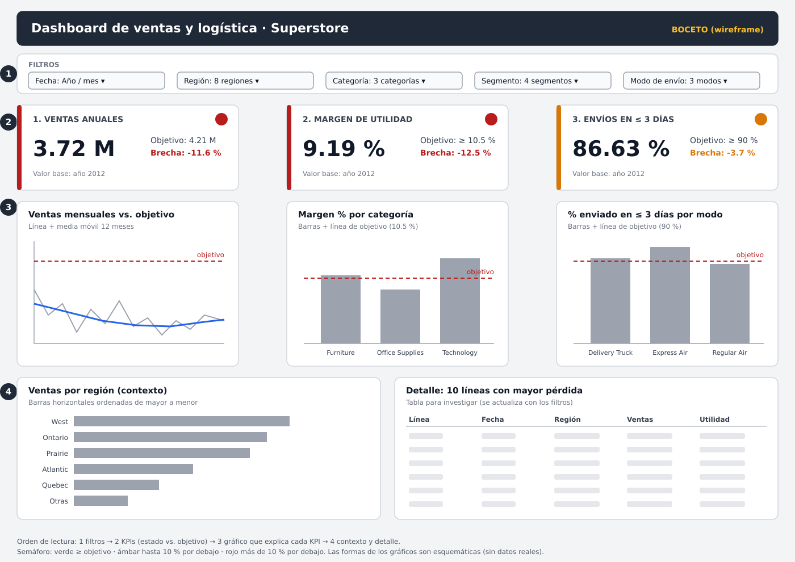

# Ciencia de Datos · Semana 13 · Diseña un dashboard

**Caso:** Ventas y logística de una empresa de suministros de oficina
**Programa:** Ingeniería Industrial · **Unidad 3:** Análisis temporal, visualización y optimización
**Autor:** Angelica Vargas Zambrano · **GitHub:** [avargas-2024a-del](https://github.com/avargas-2024a-del) · **Periodo:** 2026-B
**Herramientas:** Python 3, pandas (valores base), figura SVG (boceto)

---

## Tabla de contenido

1. [Descripción del proyecto](#1-descripción-del-proyecto)
2. [Proceso elegido y datos base](#2-proceso-elegido-y-datos-base)
3. [KPIs con su objetivo](#3-kpis-con-su-objetivo)
4. [Boceto del dashboard](#4-boceto-del-dashboard)
5. [Gráfico asociado a cada KPI](#5-gráfico-asociado-a-cada-kpi)
6. [Filtros](#6-filtros)
7. [Jerarquía visual justificada](#7-jerarquía-visual-justificada)
8. [Script de valores base](#8-script-de-valores-base)
9. [Conclusiones](#9-conclusiones)
10. [Referencias](#10-referencias)

---

## 1. Descripción del proyecto

Esta guía de la Semana 13 pide elegir un proceso, definir **3 KPIs con su objetivo**, **bocetar un dashboard** (qué gráfico va con cada KPI y qué filtros tendrá) y **justificar el orden y la jerarquía visual**.

Se eligió el proceso de **ventas y logística** de la empresa del dataset Superstore Sales, el mismo de los trabajos anteriores. Es un **boceto** (wireframe): muestra la estructura del tablero, no un tablero funcionando. Los valores base de los KPIs sí son **reales** y salen del dataset con el script de la sección 8.

| Requisito de la guía | Dónde se cumple |
|---|---|
| 3 KPIs con su objetivo | Sección 3 |
| Boceto del dashboard (imagen) | Sección 4 (`boceto_dashboard.svg`) |
| Qué gráfico va con cada KPI | Sección 5 |
| Filtros (fecha, producto, etc.) | Sección 6 |
| Justificar el orden/jerarquía visual | Sección 7 |

---

## 2. Proceso elegido y datos base

| Característica | Detalle |
|---|---|
| **Proceso** | Ventas y logística de envíos |
| **Dataset** | Superstore Sales (`superstoreSales.csv`) |
| **Fuente** | Repositorio público `curran/data` en GitHub, carpeta `superstoreSales` |
| **Enlace directo al CSV** | <https://raw.githubusercontent.com/curran/data/gh-pages/superstoreSales/superstoreSales.csv> |
| **Registros** | 8,399 líneas de pedido, de 2009 a 2012 |

Valores de cada KPI por año (resultado del script de la sección 8):

| Año | Ventas totales | Margen de utilidad (%) | Días de envío (promedio) | Líneas enviadas en ≤ 3 días (%) |
|---:|---:|---:|---:|---:|
| 2009 | 4,209,139.46 | 10.32 | 1.92 | 87.13 |
| 2010 | 3,549,680.80 | 10.25 | 2.23 | 84.73 |
| 2011 | 3,436,816.70 | 11.10 | 1.95 | 87.11 |
| 2012 | 3,719,963.86 | 9.19 | 2.02 | 86.63 |

El promedio del margen entre 2009 y 2011 es **10.56 %**. El año 2012 es el más reciente del dataset y se usa como **valor base** del dashboard.

---

## 3. KPIs con su objetivo

| # | KPI | Fórmula | Valor base (2012) | Objetivo propuesto | Brecha | Estado |
|---:|---|---|---:|---:|---:|---|
| 1 | **Ventas anuales** | Suma de `sales` en el periodo | 3.72 M | 4.21 M | -11.6 % | Rojo |
| 2 | **Margen de utilidad** | `SUM(profit)` / `SUM(sales)` × 100 | 9.19 % | ≥ 10.5 % | -12.5 % | Rojo |
| 3 | **Envíos en ≤ 3 días** | Líneas con (`ship_date` - `order_date`) ≤ 3 días / total de líneas × 100 | 86.63 % | ≥ 90 % | -3.7 % | Ámbar |

**Semáforo:** verde si el KPI cumple o supera el objetivo; ámbar si está hasta un 10 % por debajo; rojo si está más de un 10 % por debajo.

**De dónde salen los objetivos.** Los objetivos son **propuestas** para este ejercicio (el dataset no trae metas de la empresa), y se apoyan en los propios datos:

- **Ventas (4.21 M):** es el nivel de 2009, el año más alto del periodo. Plantea recuperar lo perdido.
- **Margen (≥ 10.5 %):** es aproximadamente el promedio de 2009 a 2011 (10.56 %); 2012 quedó por debajo, con 9.19 %.
- **Envíos (≥ 90 %):** el porcentaje histórico estuvo entre 84.73 % y 87.13 %, así que 90 % es una meta exigente pero alcanzable.

**Por qué estos tres KPIs.** Cubren las tres preguntas básicas del proceso: ¿cuánto se vende (volumen)?, ¿cuánto se gana de lo que se vende (rentabilidad)? y ¿se entrega a tiempo (servicio)? Se eligió el porcentaje de envíos en ≤ 3 días y no el promedio de días, porque el promedio (1.92 a 2.23 días) casi no cambia entre años y un porcentaje permite fijar una meta clara.

---

## 4. Boceto del dashboard



Las formas de los gráficos son **esquemáticas**: indican el tipo de gráfico y dónde va cada cosa, no datos reales. Los únicos números reales del boceto son los valores base y los objetivos de las tarjetas de KPI.

---

## 5. Gráfico asociado a cada KPI

| KPI | Gráfico | Por qué este gráfico |
|---|---|---|
| **1. Ventas anuales** | Línea de ventas mensuales con su media móvil de 12 meses y una línea punteada con el objetivo | Muestra la evolución en el tiempo y permite ver si la tendencia se acerca o se aleja de la meta (se apoya en lo visto en la Semana 11). |
| **2. Margen de utilidad** | Barras del margen por categoría de producto, con la línea del objetivo (10.5 %) | Compara categorías y muestra cuáles están por debajo de la meta. |
| **3. Envíos en ≤ 3 días** | Barras del porcentaje por modo de envío, con la línea del objetivo (90 %) | Compara los modos de envío y señala dónde está el incumplimiento. |
| *Contexto* | Barras horizontales de ventas por región | Ordenadas de mayor a menor, muestran dónde se concentran las ventas. |
| *Detalle* | Tabla de las 10 líneas con mayor pérdida | Permite investigar casos concretos cuando el margen está en rojo. |

---

## 6. Filtros

Todos los filtros afectan a **todo el tablero**. Cada uno corresponde a una columna real del dataset:

| Filtro | Columna | Valores |
|---|---|---|
| **Fecha** | `order_date` | Año y mes (2009 a 2012) |
| **Región** | `region` | Atlantic, Northwest Territories, Nunavut, Ontario, Prairie, Quebec, West, Yukon |
| **Categoría de producto** | `product_category` | Furniture, Office Supplies, Technology |
| **Segmento de cliente** | `customer_segment` | Consumer, Corporate, Home Office, Small Business |
| **Modo de envío** | `ship_mode` | Delivery Truck, Express Air, Regular Air |

Nota: el archivo original escribe la región "Prairie" como "Prarie"; el filtro usa el nombre corregido (limpieza hecha en el Corte 2). La guía menciona "planta" como ejemplo de filtro, pero este dataset no tiene esa columna, por eso se usaron región y categoría.

---

## 7. Jerarquía visual justificada

El tablero se lee de **arriba hacia abajo** y de **izquierda a derecha**, en cuatro niveles (los números del boceto):

1. **Filtros (arriba).** Van primero porque definen qué datos se están viendo; todo lo demás depende de ellos.
2. **Tarjetas de KPI (segunda fila).** Es lo más importante: el valor grande, el objetivo, la brecha y el semáforo responden en pocos segundos "¿vamos bien o mal?". Están arriba y con letra grande porque el ojo llega primero a la zona superior izquierda. El orden de izquierda a derecha es de más general a más específico: ventas, rentabilidad y servicio.
3. **Gráfico de cada KPI (tercera fila).** Cada gráfico queda **justo debajo de su tarjeta**, en la misma columna, para que se entienda que explica ese KPI: la tarjeta dice *qué* pasa y el gráfico muestra *dónde o cuándo*.
4. **Contexto y detalle (abajo).** Las ventas por región y la tabla de pérdidas sirven para profundizar, pero no son lo primero que se necesita; por eso van al final.

El **color** también sigue una jerarquía: los gráficos son grises, y el color fuerte (rojo y ámbar) se reserva para el semáforo y la línea del objetivo, que es lo que debe llamar la atención.

---

## 8. Script de valores base

El mismo script está en el archivo [`kpis_base.py`](kpis_base.py) de esta carpeta. Calcula los valores de la sección 2 y lista los valores disponibles para los filtros.

```python
import pandas as pd

URL = ("https://raw.githubusercontent.com/curran/data/gh-pages/"
       "superstoreSales/superstoreSales.csv")

# ---------------------------------------------------------------
# 1) CARGA Y PREPARACIÓN
# ---------------------------------------------------------------
df = pd.read_csv(URL, encoding="mac_roman")
df.columns = (df.columns.str.strip().str.lower()
                        .str.replace(r"[\s\-]+", "_", regex=True))
df["order_date"] = pd.to_datetime(df["order_date"], format="%m/%d/%Y")
df["ship_date"] = pd.to_datetime(df["ship_date"], format="%m/%d/%Y")
df["region"] = df["region"].replace({"Prarie": "Prairie"})   # error de ortografía del archivo
df["anio"] = df["order_date"].dt.year
df["dias_envio"] = (df["ship_date"] - df["order_date"]).dt.days

# ---------------------------------------------------------------
# 2) VALORES BASE DE LOS 3 KPIs, POR AÑO
# ---------------------------------------------------------------
por_anio = df.groupby("anio").agg(ventas=("sales", "sum"),
                                  utilidad=("profit", "sum"),
                                  dias_envio_prom=("dias_envio", "mean"),
                                  lineas=("sales", "count"))
por_anio["margen_pct"] = por_anio["utilidad"] / por_anio["ventas"] * 100
por_anio["pct_envio_3dias"] = (df.assign(ok=df["dias_envio"] <= 3)
                                 .groupby("anio")["ok"].mean() * 100)

print("KPIs base por año:")
print(por_anio[["ventas", "margen_pct", "dias_envio_prom", "pct_envio_3dias"]]
      .round(2).to_string())

print("\nPromedio del margen 2009-2011:",
      round(por_anio.loc[2009:2011, "margen_pct"].mean(), 2), "%")

# ---------------------------------------------------------------
# 3) CAMPOS DISPONIBLES PARA LOS FILTROS
# ---------------------------------------------------------------
for campo in ["region", "product_category", "customer_segment", "ship_mode", "order_priority"]:
    print(f"\n{campo}: {sorted(df[campo].dropna().unique())}")
```

---

## 9. Conclusiones

- Se definieron **3 KPIs** (ventas anuales, margen de utilidad y envíos en ≤ 3 días), cada uno con fórmula, valor base real, objetivo y semáforo.
- En 2012, los tres están por debajo de su objetivo: ventas y margen en rojo, y envíos en ámbar.
- El boceto organiza el tablero en cuatro niveles (filtros, KPIs, gráfico de cada KPI, contexto y detalle) y cada gráfico queda junto al KPI que explica.
- Limitaciones: los objetivos son propuestas para este ejercicio, no metas reales de la empresa; el dataset no tiene datos de planta; y el boceto no es un tablero funcional.

---

## 10. Referencias

- Curran, M. (s. f.). *superstoreSales.csv* [Conjunto de datos]. Repositorio `curran/data`, GitHub. <https://raw.githubusercontent.com/curran/data/gh-pages/superstoreSales/superstoreSales.csv>
- Microsoft. (s. f.). *Power BI documentation*. <https://learn.microsoft.com/en-us/power-bi/>
- The pandas development team. (s. f.). *Group by: split-apply-combine*. <https://pandas.pydata.org/docs/user_guide/groupby.html>
- The pandas development team. (s. f.). *pandas documentation*. <https://pandas.pydata.org/docs/>
- Corporación Universitaria del Huila – CORHUILA. (2026). *Guía de actividad práctica: Ciencia de Datos, Semana 13 · Diseña un dashboard*. Material de la asignatura.
